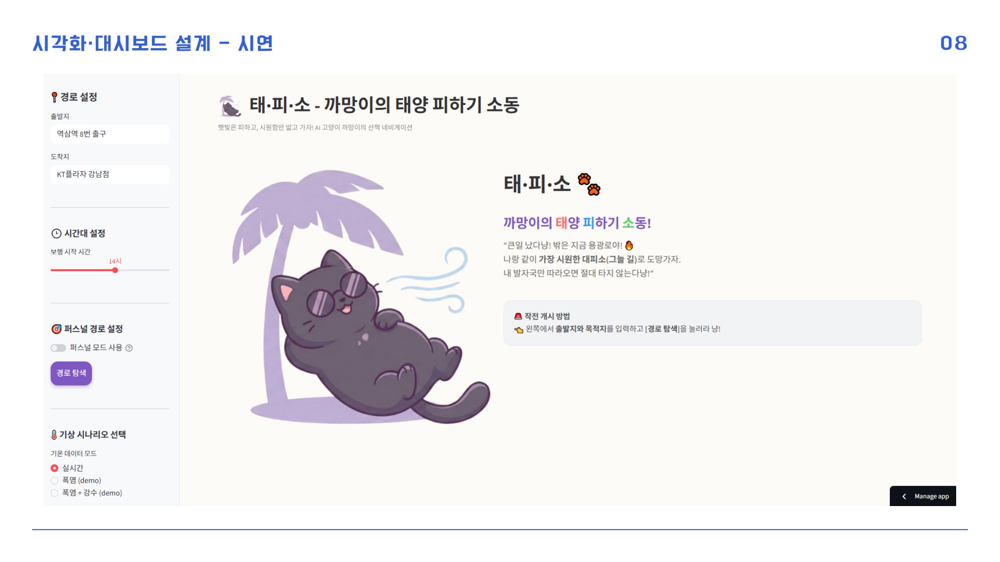
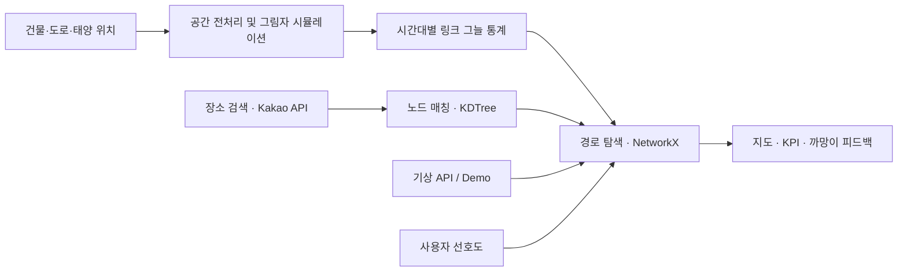

# CoolingPath 🐈‍⬛

<div align="center">

**태·피·소 — 까망이의 태양 피하기 소동**

*조금 돌아가더라도, 그늘을 따라 걷는 길.*




[주요 기능](#-key-features) · [시스템 구조](#-system-architecture) · [실행 방법](#-getting-started) · [기술 문서](docs/engineering.md)

</div>

---

## 📖 Project Overview

**CoolingPath**는 시간대별 건물 그림자와 보행 네트워크를 결합해 **그늘을 우선하는 보행 경로**를 제안하는 Streamlit 서비스입니다. 출발지·도착지와 이동 시간을 입력하면 여러 경로의 거리, 예상 소요 시간, 그늘 비율을 비교할 수 있습니다.

공공데이터를 사람이 이해할 수 있는 이야기형 시각화로 전환하기 위해, 분석 결과를 지도·KPI 카드와 고양이 캐릭터 **까망이**의 피드백으로 전달합니다.

| 기간 | 수행 환경 | 개발 범위 |
| --- | --- | --- |
| 2026.01 · 1개월 | 디토닉 BX사업본부 현장실습 | 1인 기획·데이터 전처리·경로 탐색·대시보드 개발 |

> 강남구 데이터를 활용한 **역삼–선릉 구간의 시뮬레이션 기반 PoC**입니다.

---

## ✨ Key Features

- **🗺️ 다중 경로 비교** — 최단·쿨링·큰길 우선·개인화 경로를 지도에서 비교합니다.
- **🌤️ 시간대별 그늘 반영** — 08–19시의 사전 계산된 그림자 통계를 경로 탐색에 적용합니다.
- **🎯 개인화 경로** — 그늘 선호도, 거리 우회 허용치, 육교·터널·실내 회피 조건을 설정합니다.
- **📊 경로별 KPI** — 거리, 예상 시간, 그늘 비율, 체감온도 시뮬레이션, 습도를 함께 확인합니다.
- **🌦️ 실시간·Demo 모드** — Open-Meteo 기상 정보와 폭염·강수 시나리오를 지원합니다.
- **🐈‍⬛ 상황별 피드백** — 경로 평가 결과를 까망이의 표정과 메시지로 전달합니다.

---

## 🏗️ System Architecture



그림자 생성과 공간 교차 분석은 **사전 계산**, 사용자별 비용 적용과 경로 탐색은 **앱 실행 시 처리**합니다. [설계 및 모듈 구성 →](docs/architecture.md)

---

## ⚙️ Engineering Highlights

| 기술적 과제 | 구현·설계 |
| --- | --- |
| 공간 데이터 정합성 | EPSG:5179 좌표계 통일, 도로 양측 2m 버퍼링, 건물 높이 결측 보정 |
| 복잡한 건물의 그림자 생성 | 형상을 이동·중첩하는 Shadow Ghosting과 그림자 합집합 처리 |
| 탐색 시 공간 연산 부담 | 그림자 형상과 링크별 집계 통계의 분리 설계, 사전 계산 결과 활용 |
| 위치 매칭과 경로 탐색 | KDTree 노드 매칭, 거리·그늘·시설 페널티를 반영한 가중 경로 탐색 |

[전처리 과정과 기술적 의사결정 →](docs/engineering.md)

### Simulation Result

**약 0.4분의 예상 이동 시간을 추가해, 평균 그늘 비율 +29.5%p인 대안 경로를 도출했습니다.**

| 비교 지표 | 기준 경로 | 쿨링 경로 |
| --- | ---: | ---: |
| 이동 거리 | 751.7m | 781.2m |
| 예상 소요 시간 | 11.3분 | 11.7분 |
| 평균 그늘 비율 | 5.5% | **35.0%** |

*역삼역 8번 출구 → KT강남지사, 인턴 당시 단일 경로 시뮬레이션 결과. 현장 실측값이 아닙니다.* [결과 화면 및 평가 조건 →](docs/evaluation.md)

---

## 🛠️ Getting Started

### Prerequisites

- Python **3.11+**
- Kakao **REST API Key**

### Installation

```bash
git clone https://github.com/tangerineYR/CoolingPath.git
cd CoolingPath
python -m venv .venv
```

```powershell
# Windows PowerShell
.\.venv\Scripts\Activate.ps1
```

```bash
# macOS / Linux
source .venv/bin/activate
```

```bash
python -m pip install -r requirements.txt
```

`.streamlit/secrets.toml.example`을 `.streamlit/secrets.toml`로 복사하고 API 키를 입력합니다.

```toml
KAKAO_API_KEY = "YOUR_KAKAO_REST_API_KEY"
```

```bash
python -m streamlit run app.py
```

**Access:** [http://localhost:8501](http://localhost:8501)

환경변수 설정과 Docker 실행은 [Getting Started Guide](docs/getting-started.md)를 참고하세요. Demo 모드에서도 장소 검색에는 API 연결이 필요합니다.

---

## 📂 Project Structure

```text
CoolingPath/
├── app.py                  # Streamlit 진입점
├── src/coolingpath/
│   ├── config.py           # 설정·페르소나
│   ├── data.py             # 공간 데이터 로딩
│   ├── services.py         # 장소 검색·기상 API
│   ├── routing.py          # 그래프·비용·경로 탐색
│   ├── metrics.py          # KPI 계산
│   └── ui/                 # 화면·지도·카드
├── assets/images/          # 캐릭터 이미지
├── data/                   # 원천·가공 데이터
├── docs/                   # 기술 문서·결과 화면
├── tests/                  # 경로·데이터·앱 테스트
├── pyproject.toml
└── Dockerfile
```

---

## 🧪 Tests

```bash
python -m pip install -e ".[dev]"
python -m pytest -q
```

경로 비용·우회 제한·그늘 비율·데이터 로딩·Demo 탐색을 검증합니다. 테스트는 실제 API 키 없이 실행할 수 있습니다.

## 📚 Documentation & References

- [Engineering Notes](docs/engineering.md) · [Architecture](docs/architecture.md)
- [Simulation Evaluation](docs/evaluation.md) · [Data Guide](data/README.md)
- **공간·인구 자료:** [서울 열린데이터 광장](https://data.seoul.go.kr/), [공공데이터포털](https://www.data.go.kr/)
- **기상 자료:** [기상자료개방포털](https://data.kma.go.kr/), [Open-Meteo](https://open-meteo.com/)
- **선행연구:** [Melnikov et al., Scientific Reports (2022)](https://doi.org/10.1038/s41598-022-06383-5)

데이터와 이미지에는 각 원천 자료의 이용 조건이 적용됩니다.
