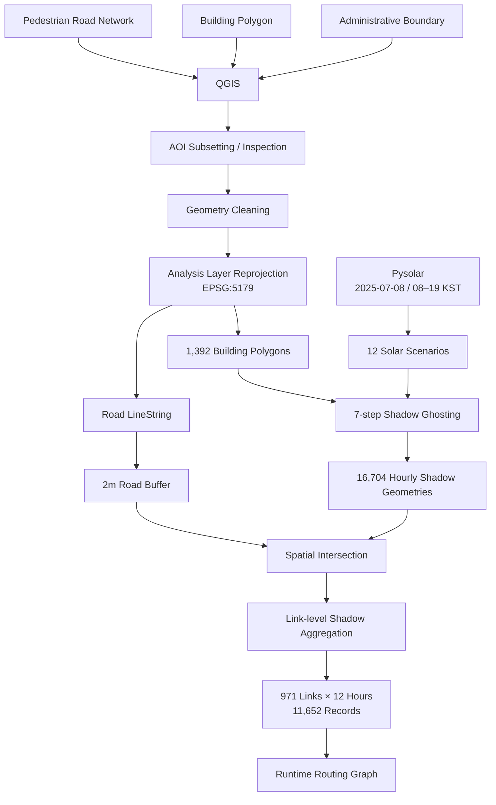
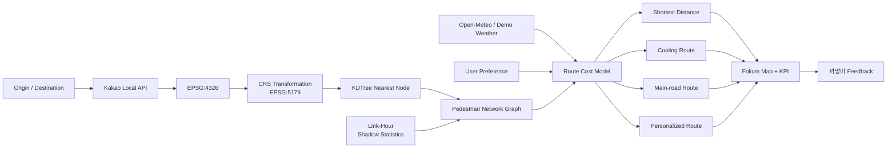
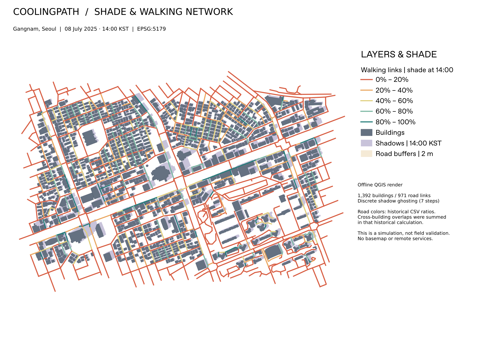

<div align="center">

# Cooling Path 🐈‍⬛

### Shade-aware Pedestrian Routing & Urban Heat Analytics

**보행 네트워크의 최단거리만을 따르지 않고,  
시간대별 건물 그림자와 보행 환경을 Graph Cost로 변환해  
폭염 상황에서 더 많은 그늘을 확보할 수 있는 대안 경로를 탐색합니다.**

<br/>

[](https://www.python.org/)
[](https://qgis.org/)
[](https://geopandas.org/)
[](https://networkx.org/)

[](https://streamlit.io/)
[](https://scipy.org/)
[](https://python-visualization.github.io/folium/)
[](https://pysolar.readthedocs.io/)
[](https://github.com/features/actions)

[](https://github.com/tangerineYR/cooling-path/actions/workflows/ci.yml)

<br/>

**태·피·소 — 까망이의 태양 피하기 소동**

_조금 돌아가더라도, 그늘을 따라 걷는 길._

<br/>

[📐 Engineering Notes](docs/engineering.md)
&nbsp;·&nbsp;
[🗺️ QGIS Workflow](docs/qgis-workflow.md)
&nbsp;·&nbsp;
[📊 Simulation Evaluation](docs/evaluation.md)

<br/>


</div>

---

## 📌 Overview

**Cooling Path**는 보행 가능한 도로망 위에서 **시간대별 건물 그림자, 기상 조건, 보행시설, 사용자 선호도**를 함께 고려해 여러 보행 경로를 비교하는 Geospatial Routing PoC입니다.

일반적인 최단 경로가 보행 네트워크의 물리적 거리만을 최소화한다면, Cooling Path는 건물과 태양 위치로 계산한 시간대별 그림자를 도로 Link 단위의 `shadow_ratio`로 변환하고 이를 Routing Cost에 반영합니다.

```text
Problem
보행 가능한 최단 경로 ≠ 폭염 상황에서 가장 쾌적한 경로

        ↓

Spatial Data
Building + Pedestrian Road + Solar Position + Weather

        ↓

Precomputation
Shadow Geometry → Spatial Intersection → Link-Hour Statistics

        ↓

Runtime Routing
Pedestrian Graph + Weather + User Preference

        ↓

Decision Support
Shortest / Cooling / Main-road / Personalized Route
```

### Project Info

| 항목 | 내용 |
| --- | --- |
| **프로젝트 유형** | 1인 현장실습 PoC |
| **수행 환경** | 디토닉 BX사업본부 현장실습 |
| **GitHub 개발 기록** | 2026.01.14 – 2026.02.06 |
| **주요 역할** | 기획 · GIS 전처리 · Shadow Modeling · Graph Routing · Dashboard |
| **분석 대상** | 강남구 내 역삼–선릉 일대 |
| **Spatial Processing** | QGIS · GeoPandas · Shapely · PyProj |
| **Routing** | NetworkX · SciPy KDTree |
| **Application** | Streamlit · Folium · Altair |
| **External Data** | Kakao Local API · Open-Meteo |

> **Portfolio Refactoring**
>
> 현장실습 당시의 Streamlit PoC를 기반으로 이후 application을
> `routing / metrics / services / data / ui` 단위로 모듈화하고,
> 재현 가능한 Shadow preprocessing script, pytest regression test,
> GitHub Actions CI, Docker/Dev Container 및 portable QGIS project를 추가했습니다.

---

## 🏗️ Architecture

### 1. Spatial Preprocessing & Shadow Pipeline



원천 공간자료에는 `EPSG:4326`, `EPSG:5186` 등 서로 다른 CRS가 존재합니다.  
거리·면적 계산에 사용하는 주요 Building/Road/Shadow 분석 레이어는 **EPSG:5179**로 재투영했습니다.

QGIS에서는 분석 영역 정제, 공간 레이어 검수 및 가공 결과 관리를 수행하고, Python preprocessing에서는 태양 위치 계산·그림자 생성·링크별 그림자 통계 산출을 재현할 수 있도록 분리했습니다.

### 2. Runtime Routing Architecture



---

## 🚀 Engineering Highlights

### 1. QGIS + GeoPandas로 이질적인 공간 데이터를 Routing-ready Dataset으로 변환

#### Problem

행정구역, 건물, 도보 네트워크 데이터는 서로 다른 공간 범위와 CRS, 데이터 형식을 가지고 있어 그대로 결합하기 어려웠습니다.

특히 그림자와 도로가 실제로 겹치는 **면적 비율**을 계산하려면 기존의 1차원 도로 `LineString`만으로는 충분하지 않았습니다.

#### Engineering Decision

QGIS에서 원천·가공 공간 레이어를 함께 관리하며 대상 영역을 정제하고, 거리·면적 분석에 사용할 주요 레이어를 `EPSG:5179`로 구성했습니다.

도로 데이터는 목적에 따라 두 형태로 분리했습니다.

```text
Road LineString
├─ Routing / Graph Topology
│
└─ 2m Buffered Road Polygon
   └─ Shadow Area Intersection
```

보존된 QGIS project에는 원천 건물·행정경계·보행 네트워크와 함께 가공된 Building/Road/Shadow layer 및 `area`, `shade_area`, `shade_rat` 등의 분석 필드가 남아 있습니다.

#### Impact

- Graph Routing용 선형 geometry와 Spatial Analysis용 면형 geometry 역할 분리
- 미터 단위의 거리·면적 연산 가능
- QGIS 분석 과정과 Python preprocessing 간 데이터 흐름 명확화
- Portable QGIS project를 별도로 구성해 portfolio 환경에서도 결과 확인 가능

<p align="center">
  
</p>

---

### 2. Convex Hull 대신 Iterative Translation 기반 Shadow Ghosting 구현

#### Problem

ㄷ자·ㄴ자처럼 오목한 형태의 건물을 단순 `Convex Hull`로 연결하면 실제로 비어 있는 공간까지 그림자로 채워 과대 추정될 수 있습니다.

#### Engineering Decision

건물 높이 `h`, 태양 고도 `α`, 방위각 `θ`로 그림자의 이동 거리를 계산했습니다.

```text
Shadow Length
L = h / tan(α)

Horizontal Translation
dx = -L × sin(θ)
dy = -L × cos(θ)
```

건물 footprint를 태양 반대 방향으로 이동시키되 한 번에 끝점까지 이동하지 않고, `steps=7`을 기준으로 원본을 포함한 **8개 위치의 geometry**를 생성합니다.

```text
Building Footprint
       │
       ├─ 0 / 7
       ├─ 1 / 7
       ├─ 2 / 7
       │   ...
       └─ 7 / 7
            │
            ▼
       unary_union
            │
            ▼
     Shadow Geometry
```

`Polygon`뿐 아니라 `MultiPolygon`도 처리하고, geometry 이동 결과를 `unary_union`해 원래 건물 형태를 최대한 유지하는 **discrete Shadow Ghosting**을 구현했습니다.

#### Impact

- 복잡한 Building Footprint를 보존하는 그림자 근사 가능
- 1,392개 건물 × 12시간에 대해 **16,704개 Shadow Geometry** 생성
- 역사적 Notebook 구현을 독립 preprocessing script로 분리하여 재현 가능성 확보

> Ghosting은 연속적인 물리 투영이 아닌 이산 근사입니다.  
> 이동 step과 실제 그림자 정확도의 관계에 대한 현장 검증은 수행하지 않았습니다.

---

### 3. Geometry-heavy 연산을 Offline Precomputation으로 분리

#### Problem

사용자가 경로를 요청할 때마다 수천 개 Building Polygon과 Road Polygon 사이의 Intersection을 수행하면 Runtime Routing에 불필요하게 큰 공간 연산 비용이 발생합니다.

#### Engineering Decision

그림자 geometry 자체와 Runtime Routing에 필요한 통계를 분리했습니다.

```text
[Offline Geometry Layer]

1,392 Buildings
×
12 Solar Scenarios
        │
        ▼
16,704 Shadow Geometries
        │
        ▼
Road × Shadow Intersection


            ↓ Aggregation


[Runtime Statistics Layer]

link_id
time_slot
shadow_ratio
        │
        ▼
971 Links × 12 Hours
= 11,652 Records
        │
        ▼
NetworkX Edge Attribute
```

Runtime에서는 Polygon Intersection을 다시 수행하지 않고 `link_id + time_slot`에 해당하는 `shadow_ratio`만 Graph에 주입합니다.

#### Data Correctness Improvement

기존 Notebook은 서로 다른 건물의 겹치는 그림자 면적을 각각 합산하는 `legacy-sum` 방식이었습니다.

Portfolio refactoring에서는 기본 정책을 다음과 같이 변경했습니다.

```text
Intersected Shadow Pieces
        ↓
union_all()
        ↓
Unique Shadow Area
        ↓
shadow_ratio
```

재현 검증 결과:

- 기존 `legacy-sum` 결과는 repository의 기존 CSV와 최대 절대 오차 약 **1.12e-15**
- 새 `union` 방식은 **2,626개 link-hour records**에서 중복 집계 면적을 감소
- 최종 결과는 항상 `0 ≤ shadow_ratio ≤ 1` 범위로 검증

#### Impact

- Heavy spatial operation과 Runtime routing path 분리
- Geometry dataset과 Serving statistics의 책임 분리
- 과거 Notebook 결과의 재현성과 개선된 aggregation을 동시에 보존

---

### 4. Euclidean Distance가 아닌 Pedestrian Network Shortest Path를 Baseline으로 정의

Cooling Path의 비교 기준은 출발지와 목적지를 직선으로 연결한 Euclidean Distance가 아닙니다.

건물과 통행 불가능 영역을 제외한 **실제 보행 도로 Graph** 위에서 Edge Length의 합이 최소가 되는 경로를 기준으로 사용합니다.

```text
P_shortest
=
arg min Σ length(e)

where
P ∈ Pedestrian Network
```

```python
path_shortest = nx.shortest_path(
    G,
    start_node,
    end_node,
    weight="length",
)
```

이를 통해 Cooling Route의 거리 증가율과 Personal Route의 detour constraint가 모두 동일한 물리적 baseline을 사용하도록 구성했습니다.

```text
Shortest Route
└─ Physical Road Length

Cooling Route
└─ Length + Heat Exposure + Walking Environment

Personalized Route
└─ Cooling Preference + Facility Avoidance
   + Detour Constraint
```

---

### 5. 최단거리 대비 우회 범위를 제한한 Shade-aware Candidate Search

현장실습 당시 실험에서는 대안 경로가 지나치게 멀어지는 것을 막기 위해 **보행 네트워크 최단거리 대비 14% 이내**의 후보를 비교했습니다.

```text
Pedestrian Shortest Distance
          │
          ▼
      × 1.14 Limit
          │
          ▼
K-Shortest Candidate Paths
          │
          ▼
     Shade Evaluation
          │
          ▼
   Cooling Alternative
```

현재 Personalized Route도 동일한 개념을 확장해 사용자가 설정한 `detour_limit` 안에서 후보 수를 제한하고 `cost_personal`이 가장 작은 경로를 선택합니다.

**14%는 성능 결과가 아니라 탐색 가능한 우회 범위에 대한 설계 기준**이며, 실제 사례의 우회율과 구분합니다.

---

### 6. CRS Transformation + KDTree로 Place Search와 Road Graph 연결

Kakao Local API가 반환하는 출발지·도착지는 WGS84 기반 위경도 좌표입니다.

이를 Routing Graph와 연결하기 위해 다음 과정을 구성했습니다.

```text
Kakao Place Search
        │
        ▼
Latitude / Longitude
EPSG:4326
        │
        ▼
CRS Transformation
EPSG:5179
        │
        ▼
SciPy KDTree
        │
        ▼
Nearest Pedestrian Node
        │
        ▼
NetworkX Routing
```

매번 모든 Road Node와 거리를 순차 비교하지 않고 `KDTree`를 구축해 nearest-neighbor lookup을 수행합니다.

> 현재 nearest-node matching은 실제 건물 출입구나 도로 반대편 진입 가능성까지 판단하는 map matching은 아닙니다. 해당 한계는 기술 문서에 별도로 기록했습니다.

---

### 7. Parallel Edge를 명시적으로 처리해 Silent Overwrite 방지

#### Problem

실제 도로 데이터에는 동일한 두 Node 사이를 연결하는 복수의 Road Link가 존재할 수 있습니다.

단순 `nx.Graph`에 이를 순서대로 추가하면 이전 Edge가 조용히 덮어써질 수 있으며, 서로 다른 `link_id`, 길이, 그림자 비율이 손실될 수 있습니다.

#### Engineering Decision

현재 PoC에서는 Simple Graph를 유지하되, Parallel Edge를 탐지해 **최단 Link 우선 + `link_id` 안정 정렬** 정책을 명시했습니다.

```text
Same (u, v)
   │
   ├─ Link A
   └─ Link B
        │
        ▼
Minimum Length
        │
Tie
        ▼
Lexical link_id
```

제외된 Link는 `G.graph["omitted_parallel_links"]`에 기록하고 `UserWarning`을 발생시켜 silent data loss를 방지합니다.

Regression Test에서는 입력 순서가 달라져도 동일한 Edge가 선택되는지 검증합니다.

> 이는 현재 PoC를 위한 명시적 Simple Graph 정책이며, 모든 parallel route를 독립적으로 탐색하는 `MultiGraph` 구현은 향후 개선 과제입니다.

---

### 8. 외부 Weather API를 Routing Context로 안전하게 전달

Open-Meteo의 시간대별:

- Temperature
- Precipitation
- Relative Humidity

정보를 Routing/UI context로 사용합니다.

외부 API 응답을 그대로 신뢰하지 않고 다음 validation boundary를 거칩니다.

```text
HTTP Request
    ↓
timeout=5s
    ↓
raise_for_status()
    ↓
JSON Parsing
    ↓
Hourly Schema Validation
    ↓
Finite Numeric Validation
    ↓
08–19 KST Forecast
```

다음 오류는 Routing Logic으로 전달하지 않습니다.

- HTTP failure
- Timeout
- Malformed JSON
- 서로 다른 길이의 hourly arrays
- 중복된 시간
- `NaN` / `Infinity`
- 음수 강수량
- `0–100` 범위를 벗어난 습도
- 현재 날짜의 08–19시 데이터 부재

실시간 기상 데이터를 사용할 수 없는 경우 Demo mode를 통해 PoC 기능을 확인할 수 있습니다.

---

### 9. 측정값과 Simulation Proxy를 구분한 KPI 설계

경로 비교 화면에서는 다음 정보를 제공합니다.

```text
Distance
Estimated Travel Time
Length-weighted Shadow Ratio
Shade-adjusted Temperature
Humidity
Walking Obstacles
```

특히 온도 지표는 실제 Heat Index, WBGT, UTCI가 아닙니다.

```text
Shade-adjusted Temperature
=
Air Temperature
-
Average Shadow Ratio × 5℃
```

라는 heuristic simulation이므로 UI에서도 기존의 `체감온도` 대신 **`그늘 보정 온도`**로 명확하게 구분했습니다.

이를 통해 실제 측정·검증된 건강 지표와 서비스 내부 simulation proxy가 혼동되지 않도록 했습니다.

---

### 10. Quantified Simulation Result

현장실습 당시 **역삼역 8번 출구 → KT강남지사** 단일 경로 simulation에서는 다음 결과를 기록했습니다.

| Metric | Baseline Route | Cooling Route | Change |
| --- | ---: | ---: | ---: |
| **Distance** | 751.7m | 781.2m | 약 **+3.9%** |
| **Estimated Time** | 11.3min | 11.7min | 약 **+3.5%** |
| **Average Shade** | 5.5% | **35.0%** | **+29.5%p** |

> **예상 이동시간 약 0.4분(+3.5%) 증가로 평균 그늘 비율을 5.5%에서 35.0%까지 확보한 대안 경로를 도출했습니다.**

이 수치는 **인턴 당시 단일 경로 simulation 결과이며 현장 보행·온도 실측 결과가 아닙니다.**

또한 당시 Notebook의 평균 그늘 비율은 Link별 단순 평균을 사용했으며, 현재 application의 KPI는 경로 전체의 공간적 비중을 반영하기 위해 **Link Length-weighted Average**를 사용합니다.

<p align="center">
  
</p>

---

### 11. Internship PoC를 Reproducible Portfolio Project로 리팩토링

현장실습 이후 기존 Streamlit 중심 PoC를 다음 domain으로 분리했습니다.

```text
config
data
services
routing
metrics
ui
```

또한 당시 Notebook에 있던 핵심 preprocessing 로직을 재현 가능한 command-line script로 추출했습니다.

```text
generate_solar_scenarios.py
        ↓
generate_shadows.py
        ↓
aggregate_shadow_by_link.py
```

그리고 다음 engineering environment를 추가했습니다.

```text
pytest
Ruff
GitHub Actions
Docker
Dev Container
Portable QGIS Project
```

CI에서는 Python **3.11 / 3.12** 환경에서 application뿐 아니라 routing, weather parsing, shadow preprocessing 및 QGIS project portability까지 regression test로 검증합니다.

---

## 🛠️ Tech Stack

| Category | Technology | Usage |
| --- | --- | --- |
| **GIS** | QGIS | Spatial preprocessing, inspection, layer management |
| **Geospatial** | GeoPandas | CRS conversion, spatial data processing |
| **Geometry** | Shapely | Translation, union, spatial intersection |
| **Solar Modeling** | Pysolar | Solar altitude / azimuth scenario generation |
| **CRS** | PyProj | WGS84 ↔ projected coordinate conversion |
| **Graph** | NetworkX | Pedestrian shortest path & weighted routing |
| **Spatial Index** | SciPy KDTree | Search coordinate → graph node matching |
| **Data** | Pandas | Link-hour shadow statistics |
| **Weather** | Open-Meteo | Hourly weather context |
| **Place Search** | Kakao Local API | Origin / destination search |
| **Application** | Streamlit | Interactive routing PoC |
| **Map** | Folium | Route and spatial visualization |
| **Chart** | Altair | Hourly weather visualization |
| **Testing** | pytest | Application / routing / preprocessing regression |
| **Quality** | Ruff | Static checks |
| **CI** | GitHub Actions | Python 3.11 / 3.12 validation |
| **Runtime** | Docker · Dev Container | Reproducible development environment |

---

## 📂 Project Structure

```text
cooling-path/
│
├── app.py
│
├── src/
│   └── coolingpath/
│       ├── config.py              # Paths, persona configuration
│       ├── data.py                # Spatial dataset loading
│       ├── services.py            # Kakao / Open-Meteo
│       ├── routing.py             # Graph & route-cost model
│       ├── metrics.py             # KPI calculation
│       └── ui/                    # Streamlit / Folium UI
│
├── scripts/
│   └── preprocessing/
│       ├── generate_solar_scenarios.py
│       ├── generate_shadows.py
│       ├── aggregate_shadow_by_link.py
│       └── common.py
│
├── notebooks/
│   └── shadow_generation.ipynb   # Historical experiment record
│
├── data/
│   ├── raw/
│   └── processed/
│
├── docs/
│   ├── architecture.md
│   ├── engineering.md
│   ├── evaluation.md
│   ├── qgis-workflow.md
│   ├── assets/
│   └── qgis/
│       ├── CoolingPath_QGIS.qgz
│       ├── CoolingPath_showcase.gpkg
│       ├── layer-inventory.md
│       ├── usage.md
│       └── screenshots/
│
├── tests/
│   ├── test_app.py
│   ├── test_routing.py
│   ├── test_services.py
│   ├── test_preprocessing.py
│   └── test_qgis_project.py
│
├── .github/
│   └── workflows/
│       └── ci.yml
│
├── Dockerfile
├── pyproject.toml
└── README.md
```

---

## ⚡ Quick Start

### Prerequisites

- Python **3.11+**
- Kakao **REST API Key**

### 1. Clone

```bash
git clone https://github.com/tangerineYR/cooling-path.git
cd cooling-path
```

### 2. Create Virtual Environment

```bash
python -m venv .venv
```

```bash
# macOS / Linux
source .venv/bin/activate
```

```powershell
# Windows PowerShell
.\.venv\Scripts\Activate.ps1
```

### 3. Install Application

```bash
python -m pip install -e .
```

`.env` 또는 `.streamlit/secrets.toml`에 Kakao REST API Key를 설정합니다.

```toml
KAKAO_API_KEY = "YOUR_KAKAO_REST_API_KEY"
```

### 4. Run

```bash
python -m streamlit run app.py
```

접속 주소:

```text
http://localhost:8501
```

---

## 🌤️ Reproduce Shadow Preprocessing

Application 실행에는 Pysolar가 필요하지 않기 때문에 preprocessing dependency를 별도로 분리했습니다.

```bash
python -m pip install -e ".[preprocessing]"
```

### 1. Generate Solar Scenarios

```bash
python -m scripts.preprocessing.generate_solar_scenarios \
  --date 2025-07-08 \
  --output /tmp/coolingpath/solar.csv
```

08시부터 19시까지 총 **12개의 Solar Altitude / Azimuth Scenario**를 생성합니다.

### 2. Generate Shadow Geometries

```bash
python -m scripts.preprocessing.generate_shadows \
  --buildings data/processed/processed_buildings.shp \
  --solar /tmp/coolingpath/solar.csv \
  --output /tmp/coolingpath/shadows.gpkg
```

기본 설정:

```text
Shadow Ghosting Steps : 7
Geometry Simplify     : 0.3m
Analysis CRS          : EPSG:5179
```

### 3. Aggregate Shadow by Road Link

```bash
python -m scripts.preprocessing.aggregate_shadow_by_link \
  --roads data/processed/processed_roads.shp \
  --shadows /tmp/coolingpath/shadows.gpkg \
  --overlap-policy union \
  --output /tmp/coolingpath/links.csv
```

기본 `union` 정책은 서로 다른 건물의 그림자가 겹치는 경우 해당 면적을 한 번만 집계합니다.

현장실습 당시 Notebook의 집계 방식을 재현하려면:

```bash
python -m scripts.preprocessing.aggregate_shadow_by_link \
  --roads data/processed/processed_roads.shp \
  --shadows /tmp/coolingpath/shadows.gpkg \
  --overlap-policy legacy-sum \
  --output /tmp/coolingpath/legacy-links.csv
```

를 사용할 수 있습니다.

자세한 전처리 근거와 기존 Notebook과의 차이는 [`docs/qgis-workflow.md`](docs/qgis-workflow.md)를 참고하세요.

---

## 🧪 Tests & CI

개발 및 preprocessing dependency를 함께 설치합니다.

```bash
python -m pip install -e ".[dev,preprocessing]"
```

### Test

```bash
python -m pytest -q
```

### Lint

```bash
ruff check src tests scripts app.py
```

Regression Test는 다음 영역을 검증합니다.

```text
Routing
├─ Shade-aware cost
├─ Detour constraint
├─ Pedestrian shortest-distance baseline
├─ Parallel-edge policy
└─ Length-weighted shadow KPI

Weather
├─ HTTP / timeout handling
├─ JSON validation
├─ Hourly schema validation
└─ Invalid weather-value rejection

Preprocessing
├─ Solar scenario
├─ Shadow direction / extent
├─ Overlapping shadow union
├─ File round-trip
└─ CRS validation

QGIS
├─ Portable relative path
├─ EPSG:5179 project/layer CRS
├─ Local resource validation
└─ GPKG / repository-stat consistency
```

GitHub Actions에서는 push와 Pull Request마다 Python **3.11 / 3.12** 환경에서 `Ruff + pytest`를 실행합니다.

---

## 🗺️ QGIS Portfolio Project

현장실습 당시 QGIS project에는 원천 데이터와 중간 처리 레이어, 외부 local path가 혼재되어 있었습니다.

Portfolio repository에는 원본 project를 그대로 공개하지 않고, 저장소 내부의 재현 가능한 데이터만 참조하도록 정리한 **portable QGIS project**를 제공합니다.

- [`CoolingPath_QGIS.qgz`](docs/qgis/CoolingPath_QGIS.qgz)
- [`CoolingPath_showcase.gpkg`](docs/qgis/CoolingPath_showcase.gpkg)
- [`QGIS Layer Inventory`](docs/qgis/layer-inventory.md)
- [`QGIS Usage Guide`](docs/qgis/usage.md)

Portable project는 repository-relative path와 `EPSG:5179` 기준으로 구성되어 있으며 CI에서 datasource portability를 검증합니다.

<p align="center">
  
</p>

---

## 📚 Documentation

프로젝트의 구현뿐 아니라 **근거, 실험 조건, 한계와 사후 개선사항까지 repository 안에서 함께 관리**합니다.

| Document | Description |
| --- | --- |
| [`Engineering Notes`](docs/engineering.md) | 공간 전처리, Shadow Modeling, Routing 설계와 한계 |
| [`Architecture`](docs/architecture.md) | Application module 및 Batch / Runtime 구조 |
| [`Simulation Evaluation`](docs/evaluation.md) | 현장실습 당시 단일 경로 Simulation 결과 |
| [`QGIS Workflow`](docs/qgis-workflow.md) | QGIS 자료와 Python preprocessing의 근거·재현 범위 |
| [`QGIS Usage`](docs/qgis/usage.md) | Portable QGIS project 실행 방법 |
| [`Data Guide`](data/README.md) | 데이터 구성과 사용 범위 |

### Data & References

- **공간·인구 데이터:** 서울 열린데이터광장, 공공데이터포털
- **기상 데이터:** 기상자료개방포털, Open-Meteo
- **Reference:** Melnikov et al., *Scientific Reports* (2022)

> 데이터와 이미지에는 각 원천 자료의 이용 조건이 적용됩니다.

---

## ⚠️ Scope & Limitations

Cooling Path는 **시뮬레이션 기반 PoC**이며 실제 내비게이션 서비스나 보건·의학적 열 위험 예측 시스템이 아닙니다.

현재 구현에는 다음과 같은 한계가 있습니다.

- Shadow Ghosting은 연속적인 물리 투영이 아닌 discrete approximation입니다.
- 현장 그림자 위치와의 정량적인 accuracy validation은 수행하지 않았습니다.
- 현재 그림자 scenario는 특정 기준 날짜의 태양 위치를 기반으로 합니다.
- `그늘 보정 온도`는 Heat Index, WBGT, UTCI가 아닌 heuristic indicator입니다.
- KDTree nearest-node matching은 실제 출입구나 도로 횡단 가능성을 완전하게 반영하지 않습니다.
- Simple Graph를 사용하므로 Parallel Road Link는 명시적인 대표 Edge 정책으로 처리합니다.
- Simulation 결과는 단일 경로 사례이며 일반적인 성능 향상을 의미하지 않습니다.

이 한계들은 결과를 과장하지 않고, 향후 개선 범위를 명확하게 정의하기 위해 문서화했습니다.

---

<div align="center">

### Cooling Path 🐈‍⬛

**The shortest walk is not always the coolest one.**

보행 가능한 최단거리 위에  
**공간 데이터와 열 노출 비용이라는 새로운 기준을 더했습니다.**

</div>
