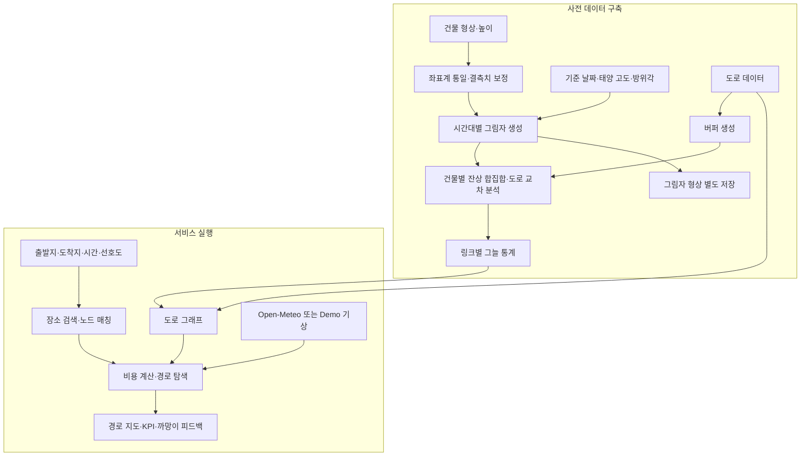

# Engineering Notes

### 1. 공간 데이터를 경로 평가에 사용할 수 있는 형태로 변환

공공데이터는 좌표계, 형상, 결측치 처리 방식이 달라 그대로 결합하기 어려웠습니다. 분석 목적에 맞춰 다음 전처리를 수행했습니다.

- **분석 레이어 재투영:** 거리·면적 분석에 사용한 주요 Building/Road/Shadow 레이어를 EPSG:5179로 재투영. 제공된 QGIS 프로젝트 CRS는 EPSG:5186이며 원천 레이어에는 EPSG:4326·5186 등이 혼재합니다.
- **도로 면적화:** 선형 도로의 양측에 2m 버퍼를 적용해, 그림자와 교차하는 면적을 계산할 수 있도록 변환.
- **건물 높이 보정:** 높이가 0이거나 누락된 건물을 층수 기반 추정과 주요 건물별 수동 보정으로 보완.
- **형식 변환:** WKT 기반 데이터를 GIS 도구와 Python에서 사용할 수 있는 GPKG·SHP 형태로 가공.

버퍼 도로는 **그늘 비율 분석용**, 선형 도로와 노드 연결 정보는 **경로 탐색용**으로 역할을 구분했습니다. 높이 보정은 일반 기준으로 층수 × 3.5m를 사용한 기록과, 특정 업무용 건물에 4.2m 층고를 적용한 기록이 있어 추정 가정과 적용 대상을 구분합니다.

### 2. 복잡한 건물 형상을 고려한 그림자 생성

단순 Convex Hull 방식은 ㄷ자·ㄴ자 형태 건물의 빈 공간까지 채워 그림자를 과대 추정할 수 있었습니다. 건물 형상을 태양 반대 방향으로 조금씩 이동하고 중첩하는 **잔상 기법(Shadow Ghosting)**을 적용해 원래 형상을 보존하도록 개선했습니다.

그림자 레이어와 도로 버퍼의 공간 중첩 결과를 링크 단위로 집계했습니다. 제공된 Notebook에서는 개별 건물의 잔상 형상을 합집합한 후 도로와 교차하고, 링크별 교차 면적을 합산합니다. 서로 다른 건물의 그림자를 전체 Dissolve했다는 근거는 확인되지 않았습니다. 따라서 건물 간 겹친 그림자가 중복 집계될 수 있으며 1을 넘는 비율을 잘라내는 것만으로 이 편향이 해결되지는 않습니다. 현장 그림자와 대조한 정확도 평가는 수행하지 않았습니다.

### 3. 사전 공간 연산과 실행 시 경로 탐색 분리

시간대별 그림자 생성과 도로 교차 분석은 사전에 수행하고, 경로 탐색에는 링크별 그늘 통계를 사용하도록 설계했습니다.

| 데이터 | 주요 필드 | 용도 |
| --- | --- | --- |
| `HOURLY_LINK_STAT` | `link_id`, `time_slot`, `shadow_ratio` | 시간대별 경로 비용 계산 |
| `HOURLY_SHADOW` | `build_id`, `time_slot`, `shadow_geometry` | 그림자 형상 보관·시각화용 데이터 |

**그림자 통계와 형상을 분리해 탐색 시 필요한 데이터를 줄이는 것**이 설계의 핵심입니다. 그림자 형상과 링크별 집계 통계를 별도로 관리하는 데이터 모델을 설계했습니다. 저장소 분리 전후의 지연 시간·메모리 벤치마크는 측정하지 않았습니다.

### 4. 경로의 효율과 그늘 확보를 함께 비교

NetworkX 기반 가중 경로 탐색에 거리·그늘·보행 시설 조건을 반영하고, KDTree로 입력 위치를 도로 노드에 연결했습니다. 사용자가 시간과 쾌적성의 차이를 비교할 수 있도록 지도와 KPI를 연결했습니다.

## 시스템 구조

그늘 비율은 도로 버퍼와 그림자가 겹치는 면적을 도로 버퍼 면적으로 나누어 산출합니다. 사전 계산된 그림자 데이터의 기준 날짜와 실시간 기상 데이터의 날짜는 별도로 관리해야 합니다.

그림자 형상은 별도 저장하도록 설계했으며, 현재 앱의 지도는 도로 경로와 그늘 통계를 중심으로 표시합니다. 위 그림은 전처리 설계와 서비스 흐름을 함께 설명합니다.

## 경로 탐색과 의사결정 지원

거리 기반 비용에 **그늘 부족과 보행 시설 조건의 페널티**를 결합해 경로를 비교합니다. 개인화 모드에서는 그늘 선호도, 시설 회피 조건, 거리 우회 허용치를 반영합니다.

| 비교 지표 | 전달하는 정보 |
| --- | --- |
| 이동 거리·예상 시간 | 대안 경로의 추가 이동 부담 |
| 길이 가중 평균 그늘 비율 | 경로 전체에서 확보되는 그늘 수준 |
| 그늘 보정 온도 | 기온 − 평균 그늘 비율 × 5℃인 휴리스틱 지표 (Heat Index·WBGT·UTCI 아님) |
| 습도·시설 정보 | 보행 환경과 장애물의 맥락 |

선행연구의 그늘 구간 상대 거리 비용 **0.86**을 참고해 인턴 기획에서 14% 우회 기준을 설정했습니다. 할인계수와 우회율은 동일한 값이 아니며, 14%는 자체 설계 기준입니다. 현재 구현은 일반 쿨링 경로의 가중 최단 경로 탐색과 개인화 모드의 거리 제약 후보 탐색을 구분합니다. [연구 근거](https://doi.org/10.1038/s41598-022-06383-5)

## 문제 해결과 설계 판단

| 문제 | 해결 접근 | 고려한 한계 |
| --- | --- | --- |
| 건물 높이 결측에 따른 그림자 누락 | 층수 기반 추정과 주요 건물 보정 | 추정 높이와 실제 높이의 차이 |
| 복잡한 건물 형상의 그림자 과대 추정 | 형상 이동·중첩 방식 적용 | 이동 간격과 공간 오차의 관계 |
| 그림자 공간 연산의 처리 부담 | 사전 계산 및 형상·통계 분리 | 날짜별 갱신 필요 |
| 검색 좌표와 도로 노드의 위치 차이 | KDTree 기반 최근접 노드 연결 | 도로 반대편·실제 진입점 오매칭 |
| 겨울철 폭염 시연의 어려움 | 과거 폭염·강수 시나리오 Demo | 실제 관측과 시나리오 구분 |
| 숫자 중심 결과의 해석 부담 | 지도·KPI·까망이 피드백 연결 | 사용자 이해도 별도 평가 필요 |

전처리 원본의 범위, QGIS와 Python의 역할, 새 재현 스크립트의 사용법과 차이는 [QGIS·전처리 작업 기록](qgis-workflow.md)을 참고하세요.
