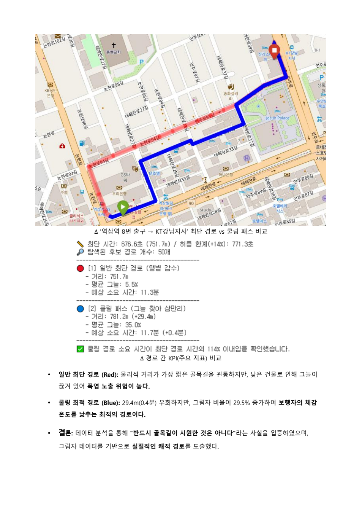

# Simulation Evaluation

## 인턴 당시 경로 비교

역삼역 8번 출구 → KT강남지사 단일 사례입니다.

| 지표 | 기준 경로 | 쿨링 경로 |
| --- | ---: | ---: |
| 거리 | 751.7m | 781.2m |
| 예상 시간 | 11.3분 | 11.7분 |
| 평균 그늘 비율 | 5.5% | 35.0% |

시간은 모델의 예상값이며 현장 보행·온도 실측은 수행하지 않았습니다. 당시 화면에는 후보 50개를 탐색한 것으로 기록되어 있으며, 현재 개인화 탐색은 최대 30개 후보를 사용합니다. 선택 시간대와 모든 실행 파라미터는 결과 화면만으로 확정할 수 없습니다. 따라서 이 표는 인턴 당시 사례이며 현재 코드의 재현 벤치마크가 아닙니다.

그늘 비율 차이는 29.5%p입니다. 원문 화면의 거리 증가 표기는 29.4m이나 표시된 두 거리의 차이는 29.5m이므로 약 30m로 해석합니다. 그늘 보정 온도는 `기온 − 길이 가중 평균 그늘 비율 × 5℃`로 계산한 휴리스틱 비교 지표이며 Heat Index·WBGT·UTCI가 아닙니다. 경로 등급도 자체 모델의 비교 지표입니다. 시간대별 그래프에는 선택 시각의 경로 평균 그늘 비율을 고정 적용하므로 시간별 그림자 변화를 예측하지 않습니다. 사용자 행동 변화와 서비스 도입 효과는 측정하지 않았습니다.
